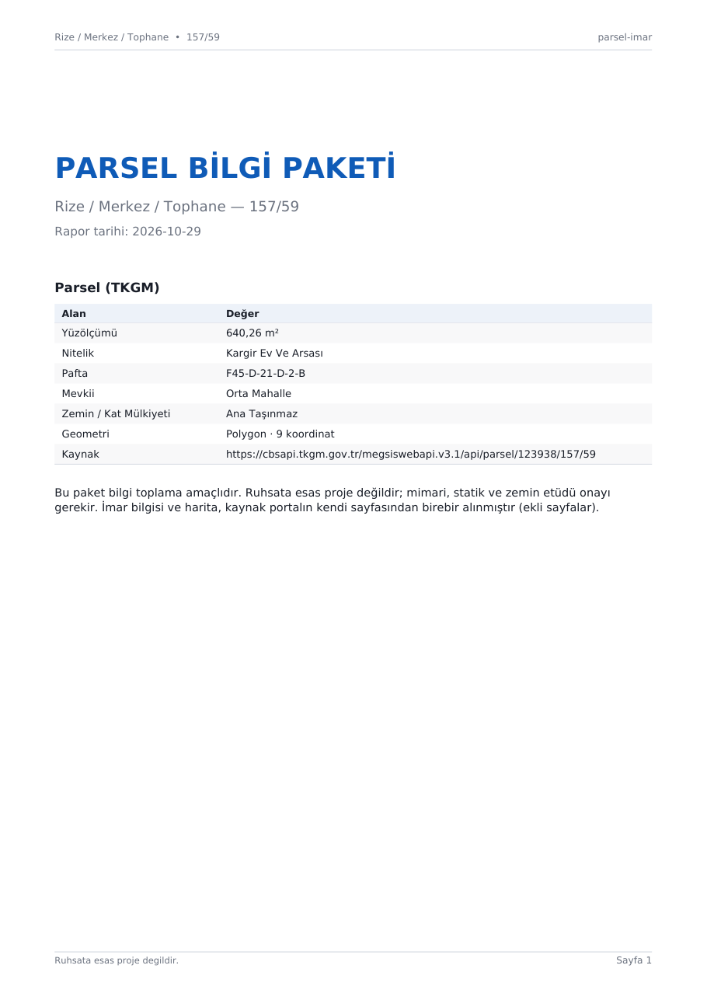
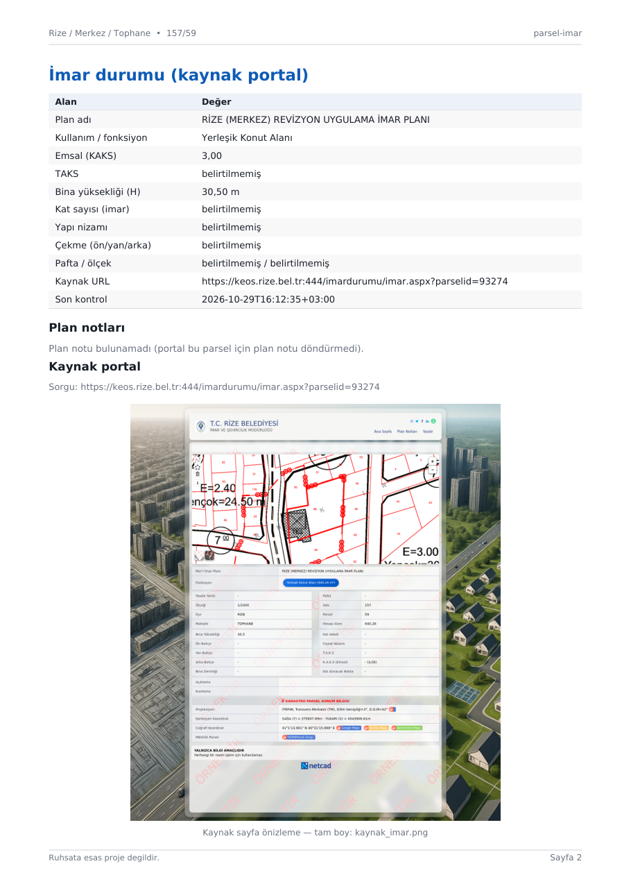
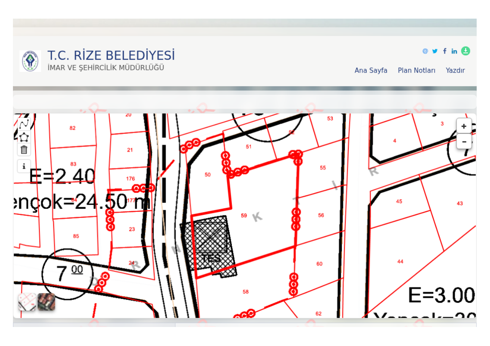
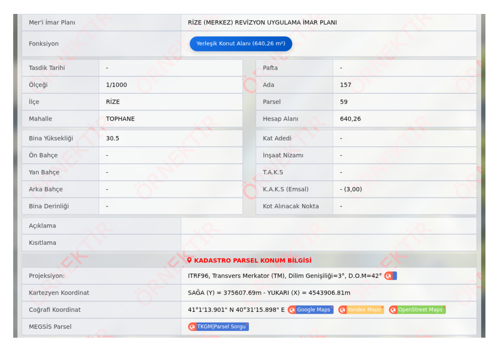

# parsel-imar v3 — çizim öncesi bilgi toplama MCP

Parsel + imar bilgisini toplar, **kaynak portalın kendi sonuç sayfasını birebir** pakete koyar.
Hesap, maliyet, kural motoru **yoktur**; ürün "karar öncesi bilgi dosyası" üretir.









---

## v2'den farkı (ne kaldırıldı, neden)

| Kaldırılan | Neden |
|---|---|
| `maliyet.py` (arsa/inşaat/proje/KDV/finansman) | Güvenilmez: birim fiyatlar ve oranlar doğrulanamıyor; kullanıcı kararı |
| `onproje.py` hesap motoru (kat, daire, dükkan, otopark, sığınak) | Kafa karıştırıyor; bu bir tasarım/fizibilite kararı, MCP işi değil |
| Kural motoru (`kural_*`, `kurallar/*.json`) | Kaynak URL'ler doğrulanamıyordu; tazelik sürekli `DOGRULANMADI` kalıyordu |
| Ölü kod (~210 satır) | `tr_lower`, `IMAR_OUT_DIR`, `_ozel_notlar`, `imar_link`, `dxf_yaz`, `_svg_rect`, `kat_plani`, `birim_yerlesimi` |

Yerine gelen: **kaynak sayfa** (portalın `imar.aspx` çıktısı, harita + tablo) ve 3 sayfalık özet.

## Araçlar (8)

| Araç | Parametreler | Döndürdüğü |
|---|---|---|
| `parsel` | `il, ilce, mahalle, ada, parsel` **veya** `lat, lon` | TKGM: alan, nitelik, pafta, mevkii, zemin/KM, geometri + GeoJSON |
| `imar_sorgula` | `il, ilce, mahalle, ada, parsel` | Emsal, TAKS, KAKS, H, kat, nizam, çekme, plan adı, kullanım, plan notları, kaynak URL |
| `imar_kapsam` | — | 20 il: portal, durum (13 aktif / 7 kapsam dışı) |
| `liste` | `tur=il\|ilce\|mahalle\|imar_il\|imar_ilce\|imar_mahalle` | TKGM ve portal listeleri |
| `cizim` | `…, crs=tm\|wgs84\|both` | `parsel.dxf` (R12, PARSEL + IMAR katmanı) + `parsel.png` (1/500 vaziyet) |
| `kaynak_sayfa` | `…, tkgm?` | Portalın `imar.aspx` sayfası: print-PDF + tam sayfa PNG (+ varsa imar planı PDF) |
| `paket` | `…, kaynak_dahil?, kaynak_sayfa_tkgm?` | **Tek çağrı:** parsel + imar + çizim + kaynak sayfa + 3 sayfalık özet → `paket.pdf` + ZIP |
| `durum` | — | Sürüm, bağımlılık durumu, cache, imar kapsamı, son hata |

**Geri uyum (1 sürüm):** `parsel_bul`→`parsel`, `parsel_sorgula`→`parsel`,
`parsel_sorgula_koordinat`→`parsel`, `parsel_dxf`→`cizim`, `parsel_imar`→`paket`,
`dosya_olustur`→`paket`, `imar_iller_listele`→`imar_kapsam`.
`on_proje` ve `kural_*` çağrılırsa net hata: *"v3'te kaldırıldı: hesap/maliyet yok"*.

## Paket içeriği

`cikti/v3/<Mahalle>_<Ada>_<Parsel>/`

| Dosya | Kaynak |
|---|---|
| `ozet.pdf` | Bizim özetimiz — 3 sayfa, A4, gömülü DejaVu, TR sayı biçimi |
| `kaynak_imar.pdf` | Portalın `imar.aspx` sayfası — **2 yatay A4 sayfa**: (1) başlık + harita, (2) bilgi tablosu. Ekran görüntüsü kırpılarak 8 mm kenarla yerleştirilir (print CSS haritayı boşalttığı için kullanılmaz) |
| `kaynak_imar.png` | Aynı sayfanın tam sayfa görüntüsü (1280 px genişlik) |
| `paket.pdf` | **Özet (3 dikey) + kaynak (2 yatay) = 5 sayfa**, tek PDF (boş/taşan sayfa yok) |
| `parsel.dxf` | R12, kapalı POLYLINE, `PARSEL` + `IMAR` etiket katmanı |
| `parsel.png` | 1/500 vaziyet: parsel, çekme sınırı (yalnız geçerli offset), ölçüler (kenardan 2,5-5 m dışa, beyaz zeminli), kuzey oku (K ayrık), ölçek |
| `rapor.json` / `rapor.md` | Tek şema: `{sorgu, parsel, imar, kaynak_sayfa, cizim, uyarilar, zaman}` |
| `paket.zip` | Yukarıdakilerin tamamı (deflate) |

Özet PDF sayfaları: **1** kapak + TKGM tablosu, **2** imar tablosu + plan notları, **3** çizim (PNG).
Kaynak sayfa(lar) hemen ardından birebir eklenir — veri elle yeniden dizilmez.

## Kurulum ve çalıştırma

```bash
git clone https://github.com/ziQzav/tkgm-parsel-mcp.git
cd tkgm-parsel-mcp
python3 server.py          # stdio JSON-RPC
```

Kurulum adımı yok: `pip install` gerekmez (opsiyonel PDF/kaynak-sayfa bağımlılıkları aşağıda).

```json
{
  "mcpServers": {
    "parsel-imar": {
      "command": "python3",
      "args": ["/PROJE/YOLU/tkgm-parsel-mcp/server.py"],
      "env": {"PARSELIMAR_CIKTI": "/PROJE/YOLU/tkgm-parsel-mcp/cikti",
              "PARSELIMAR_CACHE": "/PROJE/YOLU/tkgm-parsel-mcp/cache"}
    }
  }
}
```

### Opsiyonel bağımlılıklar

| Bileşen | Ne için | Yoksa |
|---|---|---|
| `playwright` + Chromium | `kaynak_sayfa` / `paket` kaynak PDF+PNG | `{"durum": "bagimlilik_yok"}`; paket özet PDF ile üretilir |
| `cairocffi` | Özet PDF | `ozet.pdf` atlanır, JSON/MD kalır |
| `cairosvg` | SVG → PNG | `parsel.png` atlanır |
| `pypdf` | Özet + kaynak PDF birleştirme | İki PDF ayrı kalır, `"birlestirme": "pypdf_yok"` notu |
| DejaVu Sans | Türkçe karakter | PDF atlanır |

Chromium yolu otomatik bulunur (`~/.cache/ms-playwright/chromium-*/...`), gerekirse
`PLAYWRIGHT_CHROMIUM=/yol/chrome` ile verilir. **Çekirdek araçlar (parsel, imar, liste, cizim) bu
bağımlılıkları kullanmaz.**

## Gerçek çıktılar (2026-10-29)

| Parsel | paket.pdf | kaynak_imar.pdf | ZIP | Not |
|---|---|---|---|---|
| Rize/Tophane 157/59 | 5 sayfa · 3,4 MB | 515 KB | 8,9 MB | kaynak 2 yatay sayfa |
| Aksaray/Kılıçarslan 668/214 | 5 sayfa · 3,3 MB | 393 KB | 8,9 MB | kaynak 2 yatay sayfa |

Not: kaynak sayfa raster olduğu için PDF/ZIP boyutu büyür (harita + uydu görüntüsü); metin
aranabilirliği özet sayfalarda korunur.

`paket` süresi: Rize **8,8 sn** (kaynak sayfa 8,3 sn), aynı anda özet+DXF+PNG+ZIP.

## Sınırlar

- **Resmî API değil**: TKGM `cbsapi` ve KEOS `imarsvc` uçları site arayüzünden çıkarıldı; portal değişirse kırılabilir.
- **Kaynak sayfalar** portalın ekran görüntüsüdür (print CSS haritayı boşalttığı için kullanılmaz).
  Harita ve tablo ayrı yatay A4 sayfalara kırpılır (görüntü alanı %84 / %87, kenar 8 mm);
  harita ipucu (tooltip) çekimden önce gizlenir.
- **TKGM sayfası birebir alınmıyor**: portal "Kullanım Koşulları" modalı ve özel dropdown'lar
  kullanıyor; v3'te TKGM verisi özet tabloda yer alır (`kaynak_sayfa_tkgm` deneysel bayrak).
- **Hesap/maliyet yok**: daire sayısı, inşaat alanı, maliyet hesaplanmaz; bu kararlar mimara aittir.
- **İmar cache 24 saat**; plan tadilatı aynı gün yansımayabilir. `imar_sorgula` kaynak URL ve zaman döner.
- **7 il kapsam dışı** (giriş/captcha/bakım/404/503/zaman aşımı); `imar_kapsam` nedeniyle listeler.
- Yasal: çıktı **ruhsata esas proje değildir**; TKGM kullanım koşulları ticari kullanımı sınırlar,
  veri yalnızca kullanıcının kendi sorgusu için alınır.

## Testler

```bash
python3 test_mcp.py            # offline: 28 kontrol (şema, alias, parser, DXF/PNG, PDF, birleştirme, ZIP, sayfa metrikleri)
python3 test_mcp.py --online   # 25 kontrol: 2 gerçek parsel + kaynak sayfa + sayfa/görsel metrikleri
```

Offline mod ağa çıkmaz: TKGM/imar/kaynak fonksiyonları fixture ve mock ile değiştirilir.

## Lisans

MIT © 2026 OpenBot ekibi.
