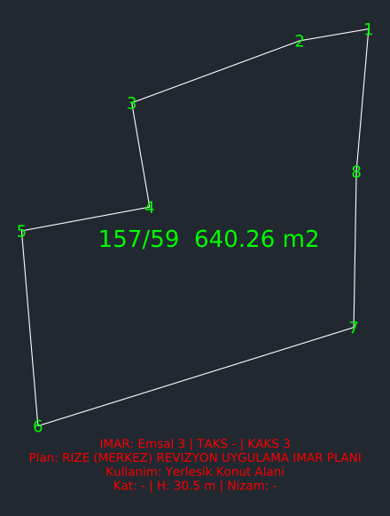

# mcp-parsel-imar — TKGM parsel + imar durumu (tek MCP sunucusu)

İki ayrı MCP'yi tek stdio sunucusunda birleştirir:

- **TKGM kadastro** (7 araç): il/ilçe/mahalle listeleri, ada/parsel sorgusu, koordinattan parsel, DXF (EPSG 5253–5262, saf stdlib TM).
- **e-İmar** (4 araç): Netcad KEOS tabanlı 20 ilin **13'ünde** ada/parsel ile imar durumu (emsal, TAKS, KAKS, kat, nizam, H, çekme, plan notu).
- **Birleşik** (1 araç): `parsel_imar` — tek çağrıda TKGM + imar + **IMAR katmanlı DXF**.

Harici bağımlılık **yoktur**: Python 3.8+ standart kütüphanesi. Resmî API değildir; portalların kendi uçları kullanılır.

## Çalışan iller (13) — hepsi Netcad KEOS e-İmar

İmar sorgusu, il belediyelerinin **Netcad KEOS** (bazılarında BELNET/e-Belediye adıyla) imar modülünden okunur.
Aynı servis ailesi, il bazında farklı URL ve HTML tablosu kullanır; tek adaptör + il config ile çözülür.
`svc_nonce` cookie'si ile `X-Service-Nonce` header'ı eşit olmalıdır (yoksa HTTP 403).

| # | İl | KEOS portalı | Not |
|---|---|---|---|
| 1 | Amasya | `keos.amasya.bel.tr/imardurumu` | — |
| 2 | Burdur | `keos.burdur.bel.tr:444/imardurumu` | — |
| 3 | Diyarbakır | `cbs.diyarbakir.bel.tr/imardurumu` | bazı parsellerde plan yok |
| 4 | Isparta | `keos.isparta.bel.tr/imardurumu` | bazı parsellerde plan yok |
| 5 | Kırşehir | `keos.kirsehir.bel.tr/imardurumu` | http |
| 6 | Nevşehir | `keos.nevsehir.bel.tr/imardurumu` | sertifika zinciri doğrulanamıyor (hosta özel) |
| 7 | Niğde | `keos.nigde.bel.tr/imardurumu` | — |
| 8 | Rize | `keos.rize.bel.tr:444/imardurumu` | — |
| 9 | Sivas | `keos.sivas.bel.tr/imardurumu` | sertifika zinciri doğrulanamıyor (hosta özel) |
| 10 | Tunceli | `cbs.tunceli.bel.tr/imardurumu` | http |
| 11 | Şanlıurfa | `keos.sanliurfa.bel.tr/imardurumu` | ISO-8859-9 |
| 12 | Uşak | `keos.usak.bel.tr/imardurumu` | — |
| 13 | Aksaray | `ebelediye.aksaray.bel.tr:444/imardurumu` | ISO-8859-9 |

**Kapsam dışı (7):** Adana ve Samsun (kurumsal giriş), Giresun (bakımda), Kahramanmaraş (reCAPTCHA), Tokat (imar modülü 404), Van (HTTP 503), Hatay (imar sayfası yanıt vermiyor).
Bu illerde `parsel_imar` yine TKGM kadastro verisini döndürür; imar alanında `hata_tipi: "imar_kapsam_disi"` + engel + portal linki bulunur. Giriş yapılmaz, captcha çözülmez.



---

## Kurulum

```bash
git clone https://github.com/ziQzav/tkgm-parsel-mcp.git
cd tkgm-parsel-mcp
python3 --version        # 3.8+
python3 server.py         # stdio, satır bazlı JSON-RPC 2.0
```

Kurulum adımı yok: `pip install` veya sanal ortam gerekmez.

MCP istemci yapılandırması (yol sizin makinenize göre):

```json
{
  "mcpServers": {
    "parsel-imar": {
      "command": "python3",
      "args": ["/PROJE/YOLU/tkgm-parsel-mcp/server.py"],
      "env": {
        "PARSELIMAR_CIKTI": "/PROJE/YOLU/tkgm-parsel-mcp/cikti",
        "PARSELIMAR_CACHE": "/PROJE/YOLU/tkgm-parsel-mcp/cache"
      }
    }
  }
}
```

OpenCode karşılığı:

```json
{
  "$schema": "https://opencode.ai/config.json",
  "mcp": {
    "parsel-imar": {
      "type": "local",
      "command": ["python3", "/PROJE/YOLU/tkgm-parsel-mcp/server.py"],
      "enabled": true
    }
  }
}
```

---

## Araçlar (12)

| Araç | Parametreler | Döndürdüğü |
|---|---|---|
| `iller_listele` | — | 81 il (plaka kodu id) |
| `ilceler_listele` | `il_id` | TKGM ilçeleri |
| `mahalleler_listele` | `ilce_id` | TKGM mahalleleri |
| `parsel_sorgula` | `mahalle_id, ada, parsel` | TKGM özeti + GeoJSON |
| `parsel_bul` | `il_adi, ilce_adi, mahalle_adi, ada, parsel` | İsimden id çözer + özet |
| `parsel_sorgula_koordinat` | `lat, lon` | Noktadaki kadastral parsel |
| `parsel_dxf` | `…, crs: tm\|wgs84\|both` | DXF (PARSEL + PARSEL_ETIKET) |
| `imar_iller_listele` | — | 20 il: durum, portal, engel notu |
| `imar_ilceler_listele` | `il` | Portalın ilçe listesi |
| `imar_mahalleler_listele` | `il, ilce` | İdari + tapu mahalleleri |
| `imar_sorgula` | `il, ilce, mahalle, ada, parsel` | İmar kaydı (tek portal) |
| `parsel_imar` | `il, ilce, mahalle, ada, parsel, dxf=true, crs="tm"` | **TKGM + imar + DXF tek çağrıda** |

`parsel_imar` imar bulamazsa TKGM verisini yine döndürür; imar alanında
`hata_tipi: "imar_kapsam_disi"` + `engel` (giris_gerekli / captcha / bakimda / …) + portal linki olur.

## Gerçek örnekler (2026-10-29 ölçümü)

**Rize / Merkez / Tophane 157/59**

```json
{
  "tkgm": {"alan_m2": 640.26, "nitelik": "Kargir Ev Ve Arsası", "koordinat_sayisi": 9},
  "imar": {"plan_adi": "RİZE (MERKEZ) REVİZYON UYGULAMA İMAR PLANI",
           "emsal": 3.0, "kaks": 3.0, "taks": null, "bina_yuksekligi_m": 30.5,
           "kullanim_karari": "Yerleşik Konut Alanı", "durum": "ok"},
  "dxf": {"dosya": "cikti/Tophane_157_59_tm.dxf", "epsg": 5258, "imar_katmani": true}
}
```

**Aksaray / Merkez / Kılıçarslan 668/214**

```json
{
  "tkgm": {"alan_m2": 551.29, "nitelik": "5 Katlı Betonarme Apartman Ve Arsası"},
  "imar": {"plan_adi": "AKSARAY 1/1000 OLÇEKLI REVIZYON UYGULAMA IMAR PLANI",
           "emsal": 1.8, "kaks": 1.8, "taks": 0.4, "kat_sayisi": 4,
           "yapi_nizami": "A", "kullanim_karari": "Konut Alanı"},
  "dxf": {"dosya": "cikti/Kiliçarslan_668_214_tm.dxf", "epsg": 5255, "imar_katmani": true}
}
```

Diğer doğrulananlar: **Tunceli** 276/9 → emsal 1,20 · H 16,5 m; **Niğde** 104/5 → emsal 0,10 · TAKS 0,05 · kat 2;
**Burdur** 412/20 → kat 2 · nizam BİTİŞİK; **Amasya** 2061/13 → plan + açıklama notu.

## 20 il kapsam matrisi

Ölçüm: 2026-10-29, tek parsel/il, seri istek (≥500 ms). "Nonce" = `svc_nonce` cookie == `X-Service-Nonce` header zorunlu mu.

| # | İl | Portal | Nonce | imar.aspx tablosu | Ada/parsel | Durum |
|---|---|---|---|---|---|---|
| 1 | Adana | keos.adana.bel.tr/BELNET | — | — | — | 🔴 giriş gerekli (kurumsal login) |
| 2 | Amasya | keos.amasya.bel.tr/imardurumu | ✔ | ✔ | 2061/13 | 🟢 aktif |
| 3 | Burdur | keos.burdur.bel.tr:444/imardurumu | ✔ | ✔ | 412/20 | 🟢 aktif |
| 4 | Diyarbakır | cbs.diyarbakir.bel.tr/imardurumu | ✔ | ✔ | 150/4 | 🟢 aktif (parselde plan yok: "Nazım İmar Planı Mevcut Değil") |
| 5 | Giresun | keos.giresun.bel.tr/imardurumu | ✔ | ✖ (maintenance.aspx) | — | 🔴 bakımda |
| 6 | Hatay | keos.hatay.bel.tr/imardurumu | ✖ | ✖ (45 sn timeout) | — | 🔴 imar sayfası yanıt vermiyor |
| 7 | Isparta | keos.isparta.bel.tr/imardurumu | ✔ | ✔ | 140/29 | 🟢 aktif (parselde plan yok) |
| 8 | Kırşehir | keos.kirsehir.bel.tr/imardurumu (http) | ✔ | ✔ | 363/147 | 🟢 aktif |
| 9 | Kahramanmaraş | keos.kahramanmaras.bel.tr/imardurumu | ✔ | ✖ (recaptcha.aspx) | — | 🔴 captcha |
| 10 | Nevşehir | keos.nevsehir.bel.tr/imardurumu | ✔ | ✔ | 3435/350 | 🟢 aktif (TLS: sertifika zinciri doğrulanamıyor, hosta özel `CERT_NONE`) |
| 11 | Niğde | keos.nigde.bel.tr/imardurumu | ✔ | ✔ | 104/5 | 🟢 aktif |
| 12 | Rize | keos.rize.bel.tr:444/imardurumu | ✔ | ✔ | 157/59 | 🟢 aktif |
| 13 | Samsun | cbs.samsun.bel.tr/BELNET | — | — | — | 🔴 giriş gerekli |
| 14 | Sivas | keos.sivas.bel.tr/imardurumu | ✔ | ✔ | 6481/1 | 🟢 aktif (hosta özel `CERT_NONE`) |
| 15 | Tokat | keos.tokat.bel.tr | — | — | — | 🔴 imar modülü 404 |
| 16 | Tunceli | cbs.tunceli.bel.tr/imardurumu (http) | ✔ | ✔ | 276/9 | 🟢 aktif |
| 17 | Şanlıurfa | keos.sanliurfa.bel.tr/imardurumu | ✖ | ✔ | 107/3 | 🟢 aktif (ISO-8859-9) |
| 18 | Uşak | keos.usak.bel.tr/imardurumu | ✔ | ✔ | 1109/7 | 🟢 aktif |
| 19 | Van | cbs.van.bel.tr/keos | — | — | — | 🔴 HTTP 503 |
| 20 | Aksaray | ebelediye.aksaray.bel.tr:444/imardurumu | ✖ | ✔ | 668/214 | 🟢 aktif (ISO-8859-9) |

**13 aktif / 7 kapsam dışı.** Kapsam dışı iller için `parsel_imar` yine TKGM verisini döndürür, imar alanında engel + portal linki verir; uydurma veri üretilmez.

### Farklı HTML şablonları

Aynı KEOS servisi il bazında farklı tablo etiketleri kullanıyor; alan eşlemesi etiket sözlüğüyle yapılıyor:

| Şablon | Etiket örnekleri | İller |
|---|---|---|
| A (klasik) | `Mer'i İmar Planı`, `Fonksiyon`, `T.A.K.S`, `K.A.K.S (Emsal)`, `Bina Yüksekliği` | Amasya, Kırşehir, Rize, Tunceli, Şanlıurfa |
| B (yeni) | `YÜRÜRLÜKTEKİ İMAR PLANI` (bölüm başlığı), `Plan Fonksiyonu`, `Yükseklik`, `T.A.K.S.`, `Ada / Parsel` | Burdur, Diyarbakır, Isparta, Uşak |
| C | `Fonksiyon Adı`, `Plan Onama Tarihi` | Niğde |
| D | `Meri İmar Planı`, `Kroki Ölçeği`, `İdari Mahallesi` | Sivas |
| E | `Plan Fonksiyon`, `Plan Onay Tarih/Sayısı` | Aksaray |
| F | `KMLDOWNLOAD`, `Mer'i İmar Planı / Tadilatın Konusu` | Nevşehir |

## DXF ve IMAR katmanı

`crs=tm` (varsayılan) / `wgs84` / `both`. Katmanlar:

| Katman | İçerik |
|---|---|
| `PARSEL` | kapalı `POLYLINE` (AutoCAD R12, AC1009) |
| `PARSEL_ETIKET` | köşe numaraları + merkezde `ada/parsel  alan m²` |
| `IMAR` | 4 satır: `Emsal / TAKS / KAKS`, `Plan: …`, `Kullanim: …`, `Kat / H / Nizam` |

`parsel_imar` IMAR katmanını otomatik ekler; `parsel_dxf` (salt kadastro) eklemez.

## Davranış

- Seri istek, aralarında **≥500 ms**; tek parsel (toplu tarama yok), 3 deneme, disk önbellek.
- Önbellek: imar **24 saat**, il/ilçe/mahalle listeleri **7 gün**, ada/parsel eşleşmesi 6 saat, TKGM parsel 1 saat.
- Hata tipleri: `bulunamadi`, `belirsiz`, `kapsam_disi`, `giris_gerekli`, `captcha`, `bakimda`, `modul_yok`, `erisilemedi`, `zaman_asimi`, `ag_hatasi`.
- Mahalle eşlemesi: TKGM mahalle adı ile KEOS **tapu mahallesi** farklı olabilir (ör. Rize 46 idari / 113 tapu). Sonuçlarda `mahalle_esleme: {tkgm, keos}` döner; ada/parsel birden fazla mahallede varsa aday listesi verilir.
- TLS: varsayılan **doğrulama açık**. Yalnız `keos.nevsehir.bel.tr` ve `keos.sivas.bel.tr` için hosta özel `CERT_NONE` (sertifika zinciri eksik); genel bir `CERT_NONE` yok.

## Testler

```bash
python3 test_mcp.py            # --offline: 37 kontrol, ağ yok (fixture + projeksiyon + DXF)
python3 test_mcp.py --online   # 10 kontrol: gerçek TKGM + 4 ilde gerçek imar
```

Offline fixture'lar portalların **gerçek** yanıtlarından alındı (Rize, Burdur, Aksaray, Amasya HTML'leri).

## Sınırlar

- **Resmî API değil.** Portal/HTML değişirse il bazında kırılabilir; o il `beklenmeyen_yanit`/`bulunamadi` döner, veri uydurulmaz.
- **7 il kapsam dışı** (yukarıdaki matris): giriş, captcha, bakım, 404, 503, zaman aşımı. Bu illerde hesap açılmaz, captcha çözülmez, e-Devlet girişi yapılmaz.
- **Veri güncelliği**: sonuç portalın o anki halidir; askı/tadilat süreçleri gecikmeli yansıyabilir. Resmî işlemde belediyeden **imarlı çap** alınmalıdır; kullanım sorumluluğu kullanıcıdadır.
- **Boş alanlar normaldir**: TAKS/kat/çekme/pafta portalda çoğu parselde `-`; `null` döner.
- Kişisel veri yok: malik/hisse/takyidat okunmaz; yalnızca parselin imar parametreleri.
- DWG üretilmez (DXF her CAD programında açılır).

## Lisans

MIT © 2026 OpenBot ekibi. Kaynak siteler: TKGM (`cbsapi.tkgm.gov.tr`, `parselsorgu.tkgm.gov.tr`) ve il belediyelerinin KEOS e-İmar portalları.
