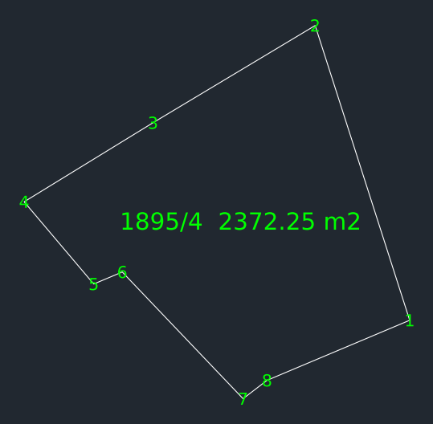

# tkgm-parsel-mcp

TKGM parsel sorgu sitesinin (`https://parselsorgu.tkgm.gov.tr/`) kullandığı
`cbsapi.tkgm.gov.tr` uçlarını saran, **salt okunur** bir MCP (Model Context Protocol)
sunucusu. Türkiye kadastral parsellerini sorgular, GeoJSON ve **CAD için DXF** üretir.

Harici bağımlılık **yoktur**: Python 3.8+ standart kütüphanesi yeterlidir.
Projeksiyon (TUREF/ITRF96 3° Transverse Mercator) saf Python ile yazılmıştır — pyproj/PROJ gerekmez.

> ⚠️ Resmî ve dokümante bir API değildir. Site arayüzü değişirse kırılabilir.



*Rize/Merkez/Hamidiye 1895/4 — `crs=tm` çıktısı (EPSG:5258), köşe numaraları ve alan etiketiyle.*

---

## Araçlar (7)

| Araç | Parametreler | Döndürdüğü |
|---|---|---|
| `iller_listele` | — | 81 il: `[{id, ad}]` (id = plaka kodu, Adana 23) |
| `ilceler_listele` | `il_id` | İlçeler: `[{id, ad}]` |
| `mahalleler_listele` | `ilce_id` | Mahalleler: `[{id, ad}]` |
| `parsel_sorgula` | `mahalle_id, ada, parsel` | Özet (il/ilçe/mahalle, alan m², nitelik, koordinat sayısı) + `cikti/<Mahalle>_<Ada>_<Parsel>.geojson` |
| `parsel_bul` | `il_adi, ilce_adi, mahalle_adi, ada, parsel` | İsimden id çözer, sonra sorgular (en çok kullanılan) |
| `parsel_sorgula_koordinat` | `lat, lon` (WGS84) | O noktadaki kadastral parsel |
| `parsel_dxf` | `il_adi, ilce_adi, mahalle_adi` **veya** `mahalle_id` + `ada, parsel` + `crs` | DXF dosyası (`tm` / `wgs84` / `both`) + EPSG, alan, koordinat özeti |

Adlar Türkçe karakterli veya ASCII olabilir (`Çankaya` = `Cankaya`); kısmi ad tek eşleşiyorsa kabul edilir.

## Kurulum

```bash
git clone https://github.com/ziQzav/tkgm-parsel-mcp.git
cd tkgm-parsel-mcp
python3 --version        # 3.8 veya üzeri
```

Kurulum adımı, `pip install`, sanal ortam gerekmez. Sunucuyu doğrudan çalıştırabilirsiniz:

```bash
python3 server.py        # stdin/stdout üzerinden JSON-RPC 2.0 bekler
```

Sunucu stdio üzerinden **satır bazlı JSON-RPC 2.0** konuşur (Content-Length başlığı yok).
Günlük mesajlar `stderr`'e yazılır, `stdout` yalnızca JSON-RPC taşır.

Varsayılan çalışma dizinleri script'in yanındadır ve ortam değişkeniyle değiştirilebilir:

| Değişken | Varsayılan | İçerik |
|---|---|---|
| `TKGMPARSEL_CIKTI` | `./cikti` | üretilen `.geojson` ve `.dxf` dosyaları |
| `TKGMPARSEL_CACHE` | `./cache` | il/ilçe/mahalle listeleri ve parsel yanıtı önbelleği |

## İstemci kurulumu

> **Mutlak yol uyarısı:** `server.py`'nin bulunduğu **tam yolu** kendiniz yazmalısınız.
> Aşağıdaki bloklarda `/PROJE/YOLU/server.py` yer tutucudur; `pwd` ile öğrenin.
> Projeyi taşırsanız istemci ayarını da güncellemeniz gerekir.

### Claude Desktop

Dosya: `~/Library/Application Support/Claude/claude_desktop_config.json` (macOS),
`%APPDATA%\Claude\claude_desktop_config.json` (Windows),
`~/.config/Claude/claude_desktop_config.json` (Linux).

```json
{
  "mcpServers": {
    "tkgm-parsel": {
      "command": "python3",
      "args": ["/PROJE/YOLU/server.py"],
      "env": {
        "TKGMPARSEL_CIKTI": "/PROJE/YOLU/cikti",
        "TKGMPARSEL_CACHE": "/PROJE/YOLU/cache"
      }
    }
  }
}
```

Değişiklikten sonra Claude Desktop'ı tamamen kapatıp açın.

### Claude Code

```bash
claude mcp add tkgm-parsel -- python3 /PROJE/YOLU/server.py
```

Kontrol: `claude mcp list`

### Cursor

Dosya: `~/.cursor/mcp.json` (veya proje içinde `.cursor/mcp.json`).

```json
{
  "mcpServers": {
    "tkgm-parsel": {
      "command": "python3",
      "args": ["/PROJE/YOLU/server.py"]
    }
  }
}
```

### OpenCode

Dosya: `opencode.json` (proje kökü) veya `~/.config/opencode/opencode.json`.

```json
{
  "$schema": "https://opencode.ai/config.json",
  "mcp": {
    "tkgm-parsel": {
      "type": "local",
      "command": ["python3", "/PROJE/YOLU/server.py"],
      "enabled": true
    }
  }
}
```

### VS Code

Dosya: `.vscode/mcp.json` (çalışma alanı) — aynı yapı `settings.json` içinde
`"mcp": { "servers": { ... } }` olarak da kullanılabilir.

```json
{
  "servers": {
    "tkgm-parsel": {
      "type": "stdio",
      "command": "python3",
      "args": ["/PROJE/YOLU/server.py"]
    }
  }
}
```

### Genel (JSON)

`command` + `args` alanlarını destekleyen her MCP istemcisi için:

```json
{
  "mcpServers": {
    "tkgm-parsel": {
      "command": "python3",
      "args": ["/PROJE/YOLU/server.py"]
    }
  }
}
```

Hazır dosyalar: `examples/claude_desktop_config.json`, `examples/opencode.json`,
`examples/cursor_mcp.json`.

## Kullanım örnekleri

İstemcinize doğal dille yazabilirsiniz:

- “Rize Merkez Hamidiye 1895/4 parselini sorgula.”
- “Ankara Çankaya Küçükesat 2531/7 parselinin DXF'ini üret, crs=tm.”
- “39.9075, 32.8620 koordinatındaki parseli bul.”
- “Adana'nın ilçelerini listele.” → `ilceler_listele(23)`
- “Kadıköy'deki mahalleleri göster.” → önce il/ilçe id'si çözülür

Elle JSON-RPC denemesi:

```bash
printf '%s\n' \
 '{"jsonrpc":"2.0","id":1,"method":"initialize","params":{"protocolVersion":"2024-11-05","capabilities":{},"clientInfo":{"name":"cli","version":"1"}}}' \
 '{"jsonrpc":"2.0","id":2,"method":"tools/call","params":{"name":"parsel_bul","arguments":{"il_adi":"Rize","ilce_adi":"Merkez","mahalle_adi":"Hamidiye","ada":"1895","parsel":"4"}}}' \
 | python3 server.py
```

Daha fazlası: [`examples/ornek_sorgu.md`](examples/ornek_sorgu.md)

### Örnek DXF çıktısı

```json
{
  "parsel": {"il": "Rize", "ilce": "Merkez", "mahalle": "Hamidiye Köyü", "mahalle_id": 123992, "ada": "1895", "parsel": "4"},
  "alan_m2": 2372.25,
  "koordinat_sayisi": 9,
  "dosyalar": [
    {"dosya": "cikti/Hamidiye_Köyü_1895_4_tm.dxf", "crs": "TUREF / TM42 (ITRF96, 3 derece Gauss-Kruger)",
     "epsg": 5258, "birim": "metre", "kapali": true, "merkez_boylam": 42.0, "alan_hesap_m2": 2389.14},
    {"dosya": "cikti/Hamidiye_Köyü_1895_4_wgs84.dxf", "epsg": 4326, "birim": "derece", "kapali": true}
  ]
}
```

## DXF ve koordinat sistemleri

`parsel_dxf` çıktısı **AutoCAD R12 (AC1009) ASCII DXF**'tir; DWG üretilmez.
DXF'i AutoCAD, LibreCAD, QCAD, BricsCAD, DWG TrueView vb. açar.

| `crs` | Dosya | EPSG | Birim |
|---|---|---|---|
| `tm` (varsayılan) | `<Mahalle>_<Ada>_<Parsel>_tm.dxf` | TUREF/TM27…TM54 (5253–5262), zondan otomatik | metre |
| `wgs84` | `<Mahalle>_<Ada>_<Parsel>_wgs84.dxf` | 4326 | **derece** |
| `both` | iki dosya | 5253–5262 + 4326 | metre + derece |

### EPSG tablosu (TUREF / ITRF96, 3° Transverse Mercator)

| Merkez boylam | Dilim | EPSG | Örnek il |
|---|---|---|---|
| 27°E | TM27 | 5253 | İzmir, Çanakkale |
| 30°E | TM30 | 5254 | Antalya, Bursa |
| 33°E | TM33 | 5255 | Ankara, Konya |
| 36°E | TM36 | 5256 | Adana, Kayseri |
| 39°E | TM39 | 5257 | Samsun, Trabzon |
| 42°E | TM42 | 5258 | **Rize**, Erzurum |
| 45°E | TM45 | 5259 | Van, Iğdır |
| 48°E | TM48 | 5260 | (doğu sınırı) |
| 51°E | TM51 | 5261 | (doğu sınırı) |
| 54°E | TM54 | 5262 | (doğu sınırı) |

Kural: `zon = round(boylam / 3)`, `merkez boylam = 3 × zon`,
`EPSG = 5253 + (merkez boylam − 27) / 3`.
Örnekler: **Rize 40,61°E → TM42 → EPSG:5258**; **Ankara 32,86°E → TM33 → EPSG:5255**.

Projeksiyon parametreleri (EPSG'den): GRS80 elipsoidi, lat_0 = 0, k = 1,0,
false easting = 500000, false northing = 0. xn = doğu (easting), yn = kuzey (northing).

Doğruluk: pyproj (PROJ) ile en büyük fark **0,16 mm**, WGS84→TM→WGS84 round-trip **0,06 mm**,
TM → WGS84 ters dönüşüm **< 1e-9 derece**.

### DXF yapısı

| Öğe | Değer |
|---|---|
| Sürüm | `AC1009` (R12 ASCII), `$DWGCODEPAGE = ANSI_1254` |
| Katmanlar | `PARSEL` (geometri), `PARSEL_ETIKET` (yazılar) |
| Geometri | Kapalı `POLYLINE` (`70=1`), köşe başına `VERTEX`, ardından `SEQEND` |
| Etiketler | Her köşede sıra numarası, merkezde `ada/parsel` + kayıt alanı (`1895/4  2372.25 m2`) |
| Hassasiyet | metre: 3 ondalık (mm); derece: 8 ondalık (~1 mm) |

**Uyarılar**

- `crs="wgs84"` çıktısında **1 birim = 1 derece**'dir; ölçekli çizim, alan/uzunluk ölçümü için
  `crs="tm"` kullanın.
- Alan etiketi TKGM **kayıt** alanıdır. `alan_hesap_m2` alanı, DXF'teki poligonun düzlemdeki
  geometrik alanıdır; TKGM'nin gösterim geometrisi nedeniyle küçük farklar olabilir
  (Rize örneği: 2.372,25 m² kayıt, 2.389,14 m² geometri — %0,7).
- R12 ASCII olduğu için `TEXT` içeriğindeki Türkçe karakterler ASCII'ye çevrilir (ı→i, ğ→g, ş→s).
- Delik (iç halka) çizilmez; TKGM parsel geometrisi tek halka gelir.
- **DWG desteklenmez**; DXF'i CAD programında "Save As → DWG" ile çevirebilirsiniz.

## Testler

```bash
python3 test_mcp.py            # --offline (varsayılan): ağ yok
python3 test_mcp.py --online   # gerçek TKGM sorguları
```

`--offline` modu ağa hiç çıkmaz: araç şemalarını, TM projeksiyonunu (bilinen koordinat +
round-trip) ve DXF üretimini depodaki örnek parselle (`tests/fixtures/`) doğrular.
CI (`.github/workflows/test.yml`) Python 3.8 / 3.10 / 3.12 üzerinde yalnızca offline modu çalıştırır.

## Hata yönetimi ve yük sınırları

- **404** → Türkçe “Parsel bulunamadı: Mahalle Id = …, Ada = …, Parsel = …”.
- **Ağ hatası** → 3 deneme (artan bekleme), sonra Türkçe hata.
- İstekler **seri**, aralarında en az **400 ms** gecikme; paralel/agresif istek yok.
- Önbellek: il/ilçe/mahalle listeleri 7 gün, parsel yanıtları 1 saat.

## Sınırlar ve hukuki not

- **Resmî API değildir.** TKGM siteyi/arayüzü değiştirirse uçlar haber verilmeden kırılabilir.
- Yalnızca **kadastral parsel geometrisi ve özet nitelikler** döner. **Tapu sahibi, hisse,
  ipotek, takyidat gibi kişisel/mülkiyet bilgisi yoktur** ve toplanmaz.
- Veriler bilgilendirme amaçlıdır; **resmî işlemlerde TKGM/tapu kayıtları esastır**. Verinin
  kullanımından ve sonuçların doğruluğundan kullanıcı sorumludur.
- **TLS sertifika doğrulaması kapalıdır** (`ssl.CERT_NONE`): TKGM sertifika zinciri bazı
  ortamlarda doğrulanamıyor. Bu, araya giren (MITM) bir bağlantının fark edilmemesi demektir;
  hassas/kurumsal ağlarda bunu bilerek kullanın. Sunucu yalnızca herkese açık kadastro
  verisini okur, kimlik doğrulama veya gizli veri göndermez.
- Salt okunur: form gönderme, hesap işlemi, yazma yok. Yalnızca `cikti/` ve `cache/` altına yazar.

## Katkı

Issue ve pull request'ler açıktır. Lütfen:

1. `python3 test_mcp.py` (offline) testlerini geçirin.
2. Yeni uç/araç eklerken README araç tablosunu ve `CHANGELOG.md`'yi güncelleyin.
3. Ağa çıkan testleri `--online` altında tutun; CI yalnızca offline çalışır.

Hata bildirirken: Python sürümü, işletim sistemi, çalıştırılan araç ve aldığınız hata metnini ekleyin.

## Lisans

[MIT](LICENSE) © 2026 ziQzav

## Kaynak URL'ler

- Site: https://parselsorgu.tkgm.gov.tr/
- İl listesi (plaka kodu): https://parselsorgu.tkgm.gov.tr/app/modules/administrativeQuery/data/ilListe.json
- İl listesi (GeoJSON): https://cbsapi.tkgm.gov.tr/megsiswebapi.v3.1/api/maksIdariYapi/illiste
- İlçe: https://cbsapi.tkgm.gov.tr/megsiswebapi.v3.1/api/idariYapi/ilceListe/{ilId}
- Mahalle: https://cbsapi.tkgm.gov.tr/megsiswebapi.v3.1/api/idariYapi/mahalleListe/{ilceId}
- Parsel: https://cbsapi.tkgm.gov.tr/megsiswebapi.v3.1/api/parsel/{mahalleId}/{ada}/{parsel}
- Koordinat: https://cbsapi.tkgm.gov.tr/megsiswebapi.v3.1/api/parsel/{lat}/{lon}/

---

# English (short)

Read-only MCP server that wraps the (unofficial) TKGM land-parcel endpoints used by
`parselsorgu.tkgm.gov.tr`. It queries Turkish cadastral parcels and exports **DXF** for CAD.

- **No dependencies:** Python 3.8+ standard library only, including the TUREF/ITRF96
  3° Transverse Mercator projection (no pyproj).
- **7 tools:** `iller_listele`, `ilceler_listele`, `mahalleler_listele`, `parsel_sorgula`,
  `parsel_bul`, `parsel_sorgula_koordinat`, `parsel_dxf`.
- **Install:** `git clone`, then point your MCP client at `python3 /ABSOLUTE/PATH/server.py`.
  Nothing to install.
- **DXF:** AutoCAD R12 ASCII, closed `POLYLINE` on layer `PARSEL`, vertex numbers and an area
  label on `PARSEL_ETIKET`. `crs=tm` → TUREF/TM zones (EPSG:5253–5262, metres),
  `crs=wgs84` → EPSG:4326 (degrees), `crs=both` → two files. Rize 1895/4 → EPSG:5258.
- **Tests:** `python3 test_mcp.py` (offline, no network) or `--online` (live TKGM).
- **Limits:** unofficial API that may break; cadastral geometry only — no owner, share or
  mortgage data; TLS verification is disabled; DWG is not supported (DXF only).
- **License:** MIT © 2026 ziQzav.
